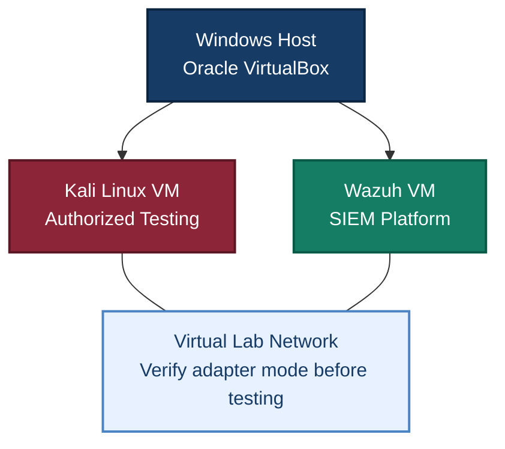

# Module 1: SOC Fundamentals & Home Lab Setup

## 📋 Module Overview

This module introduces the foundational concepts and practical environment used in a Security Operations Center (SOC) Analyst Training Program. It covers SOC analyst tiers, incident response, virtualization, SIEM deployment, network configuration, and professional lab documentation.

The practical work uses Oracle VirtualBox, Kali Linux, and the Wazuh virtual appliance. The screenshots document the current VM configuration and basic access to the lab systems.

> **Important accuracy note:** The supplied Kali network-settings screenshot shows the adapter attached to **NAT**, not Host-Only. Therefore, this report does not claim that Host-Only isolation has already been verified. Before conducting security simulations, configure and verify the intended isolated network and update the screenshot if the configuration changes.

## 🎯 Module Objectives

1. Understand Tier 1, Tier 2, and Tier 3 SOC responsibilities and the Incident Response (IR) lifecycle.
2. Install and configure Oracle VirtualBox to run multiple virtual machines.
3. Deploy Kali Linux for authorized security testing and simulated threat activity.
4. Deploy and verify the Wazuh SIEM virtual appliance.
5. Configure and verify suitable network isolation before conducting lab simulations.
6. Document practical work with screenshots and structured reports.

## 🛠️ Tools & Technologies

| Category | Tool / Technology | Purpose |
|---|---|---|
| Hypervisor | Oracle VM VirtualBox | Virtual machine management |
| Host OS | Windows 10/11 | Runs VirtualBox |
| Security testing OS | Kali Linux | Authorized testing and simulated activity |
| SIEM platform | Wazuh 4.14.9 OVA (as shown in evidence) | Security monitoring platform |
| Network modes | NAT / Host-Only | Connectivity and lab isolation, as configured |
| Package management | `apt` | Linux package updates |
| Service management | `systemctl` | Service status and control |
| Network inspection | `ip a`, `ping` | Interface and connectivity checks |

---

# 🔬 Lab 1: VirtualBox Installation & Configuration

## 1.1 Objective

Install Oracle VirtualBox and configure the host environment to run the virtual machines needed for the SOC lab.

## 1.2 Execution Steps

### Step 1 — Install VirtualBox

1. Download VirtualBox from the official Oracle website.
2. Run the installer with administrative privileges.
3. Allow the required virtual network interfaces to be installed.
4. Start VirtualBox Manager and confirm that it opens correctly.

### Step 2 — Install the Extension Pack (if required)

1. Obtain the Extension Pack that matches the installed VirtualBox version.
2. Open the `.vbox-extpack` file and follow the installation prompts.
3. Confirm that the installation completes successfully.

### Step 3 — Configure VM Storage

Open **VirtualBox → Preferences → General** and choose a suitable default VM folder. For example:

```text
D:\VMs
```

Use a folder on a drive with sufficient free space for virtual disks and snapshots.

### Step 4 — Review Network Configuration

Open the VirtualBox network settings and inspect the adapters assigned to each VM.

- **NAT** typically provides outbound connectivity through the host's network.
- **Host-Only** provides a private virtual network between the host and attached VMs, depending on its configuration.
- Do not assume a VM is isolated based only on the report text; verify its actual adapter settings.

## 1.3 Verification

- VirtualBox Manager opens successfully.
- The configured virtual machines appear in the manager.
- VM storage settings are available.
- The network mode assigned to each VM has been inspected.

## 1.4 Key Learnings & Troubleshooting

- VirtualBox is a Type-2 hypervisor that runs on a host operating system.
- VM disks and snapshots can consume substantial storage.
- NAT and Host-Only have different networking behaviors.
- If a VM fails to start, inspect VirtualBox logs, hardware virtualization settings, resource allocation, and compatibility before changing host security settings.

---

# 🔬 Lab 2: Kali Linux VM Creation & Configuration

## 2.1 Objective

Prepare Kali Linux as the authorized security-testing VM for future controlled exercises.

## 2.2 Execution Steps

### Step 1 — Create or Import the VM

Import the official Kali VirtualBox appliance or create a VM and install Kali Linux. Allocate resources according to the host computer's capacity.

**Observed configuration in the supplied screenshots:** The Kali settings screenshot shows **8192 MB RAM**. The VirtualBox overview screenshot shows **6 processors** and a **50.00 GB** virtual disk. These values differ from generic example allocations and are recorded here to match the supplied evidence.

### Step 2 — Boot Kali Linux

1. Start the VM.
2. Complete the initial setup or installation if required.
3. Confirm that the Kali login screen appears.
4. Log in using the account configured for this VM.

### Step 3 — Update Packages

In a Kali terminal, run:

```bash
sudo apt update
sudo apt upgrade -y
```

The commands refresh package metadata and install available upgrades. Internet connectivity may be needed; configure it deliberately and restore the intended isolated lab network before security simulations.

### Step 4 — Create a Baseline Snapshot

In VirtualBox:

1. Select the Kali VM.
2. Open **Snapshots**.
3. Create a snapshot after confirming that the VM is working.
4. Use a descriptive name such as:

```text
Kali - Clean Base
```

## 2.3 Verification

- Kali reaches its login screen.
- The configured user can log in.
- The terminal opens.
- Package update commands can be run.
- A baseline snapshot is present if the snapshot step has been completed.

## 2.4 Key Learnings & Troubleshooting

- OVA files can simplify VM deployment.
- `apt update` refreshes package metadata; `apt upgrade` installs available updates.
- Snapshots provide a recovery point but are not a substitute for backups.
- If performance is poor, review CPU/RAM allocation and host resource usage.

---

# 🔬 Lab 3: Wazuh SIEM Installation & Basic Verification

## 3.1 Objective

Boot the Wazuh virtual appliance, log into its server environment, and perform basic verification.

## 3.2 Execution Steps

### Step 1 — Import the Wazuh Appliance

1. Obtain the intended Wazuh OVA from the official source.
2. Import it into VirtualBox.
3. Review the VM's memory, CPU, storage, and network configuration.
4. Start the VM and wait for the login prompt.

The supplied screenshot identifies the appliance as **Wazuh 4.14.9 OVA**.

### Step 2 — Log In

Use the credentials documented for the specific appliance. The supplied login screenshot displays the following credentials:

```text
Username: wazuh-user
Password: wazuh
```

These are shown here as the credentials visible in the provided lab evidence, not as universal Wazuh defaults. If they remain valid on the VM, change the password before exposing any management service outside the isolated lab.

### Step 3 — Verify the Server Session

After logging in, run:

```bash
whoami
hostname
ip a
```

These commands display the current user, hostname, and network interfaces.

### Step 4 — Check Wazuh Services

If the appliance uses these service names and the account has permission, inspect them with:

```bash
sudo systemctl status wazuh-manager
sudo systemctl status wazuh-indexer
sudo systemctl status wazuh-dashboard
```

Service names and deployment layouts can vary. A missing service unit should be investigated against the documentation for the installed appliance rather than treated as proof that the entire installation is broken.

## 3.3 Verification

The provided evidence supports that the Wazuh VM reached its login prompt and that a terminal session was opened. To confirm full SIEM health, additionally verify the relevant services and access the dashboard if it is configured.

## 3.4 Key Learnings & Troubleshooting

- Wazuh commonly uses Manager, Indexer, and Dashboard components.
- `systemctl status` helps inspect service state.
- Dashboard access can depend on service health, network settings, firewall rules, and the appliance version.
- Change any known default or temporary credentials before broader network exposure.

---

# 🏛️ SOC Home Lab Architecture

The diagram below shows the intended logical relationship between the host, virtual machines, and lab network. It does not replace verification of the actual VirtualBox adapter settings.



**Network isolation checklist before testing**

- [x] Review the network adapter of every VM.
- [x] Confirm the intended lab subnet and routing.
- [x] Use Host-Only networking when a private lab network is required.
- [x] Ensure no unintended bridged adapter exposes the lab to the physical LAN.
- [x] Verify connectivity between only the systems that need to communicate.
---

# 📸 Screenshots & Evidence

The following direct image links point to the repository's `main` branch. They will continue to work as long as the repository remains accessible and the files are not moved or renamed.

## Screenshot 1 — VirtualBox Main Interface

Shows the VirtualBox Manager and the Kali Linux and Wazuh VMs.


## Screenshot 2 — Kali Linux System Settings

Shows Kali VM settings. The screenshot displays 8192 MB of base memory.


## Screenshot 3 — Kali Linux Network Settings

Shows the network adapter configuration. **The supplied screenshot shows “Attached to: NAT”; it does not show Host-Only mode.** Update the VM configuration and replace this screenshot if Host-Only networking is the intended final setup.


## Screenshot 4 — Kali Linux Login Screen

Shows the Kali VM at its login screen.


## Screenshot 5 — Kali Linux Terminal

Shows a terminal session in Kali Linux.


## Screenshot 6 — Wazuh VM Login Screen

Shows the Wazuh appliance login prompt and credentials visible in the supplied screenshot.


## Screenshot 7 — Wazuh Server Terminal

Shows a successful terminal session on the Wazuh VM.


# 💡 Key Takeaways

1. **Virtualization:** Virtual machines provide a practical environment for learning and testing.
2. **Network Isolation:** The network mode must be verified from the actual VM settings; do not describe a NAT configuration as Host-Only.
3. **SIEM Deployment:** Wazuh introduces the components used for security monitoring and event analysis.
4. **Snapshots:** Snapshots help recover from configuration mistakes, but important files should also be backed up.
5. **Evidence-Based Reporting:** Report only what the screenshots and tests actually demonstrate.
6. **Credential Security:** Replace default or temporary passwords and avoid exposing credentials in public documentation.

---

# ✅ Module 1 Completion Checklist

Mark each item complete only after verifying it in your environment.

- [x] Reviewed SOC Fundamentals concepts.
- [x] Installed VirtualBox and opened VirtualBox Manager.
- [x] Deployed the Kali Linux VM.
- [x] Deployed the Wazuh virtual appliance.
- [x] Captured screenshots of the VMs and settings.
- [x] Verified that the final VM network configuration matches the intended isolated lab design.
- [x] Verified the relevant Wazuh services and dashboard, where configured.
- [x] Confirmed that default or temporary credentials have been changed.
- [x] Created and verified baseline snapshots.
---

## 🚀 Next Steps

After verifying network isolation and SIEM health, proceed to:

- Linux and Windows log collection.
- SIEM dashboards and alert investigation.
- Authentication monitoring and suspicious activity detection.
- Threat intelligence and Indicators of Compromise (IoCs).
- Incident response and practical threat hunting.

**Module 1 establishes the virtualization and SIEM foundation for the SOC Analyst Training Program.**
