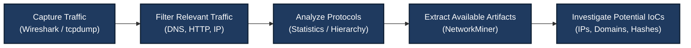

# Module 2: Network Security & Traffic Analysis — Comprehensive Lab Report

## Overview

This module focuses on network security, packet inspection, and traffic analysis. It introduces practical techniques for capturing network packets, analyzing communication protocols, identifying suspicious traffic, and extracting network artifacts using Wireshark and NetworkMiner.

Network traffic analysis is an essential skill for Security Operations Center (SOC) analysts because it helps investigate suspicious connections, potential command-and-control (C2) communication, network scanning, and possible data exfiltration.

## Objectives

By completing this module, I aimed to:

- Learn how to capture and inspect live network traffic using Wireshark.
- Apply display filters to analyze DNS, HTTP, TCP, UDP, and ICMP traffic.
- Open and investigate PCAP files containing recorded network traffic.
- Understand protocol distribution using Wireshark's Protocol Hierarchy.
- Extract available network artifacts using NetworkMiner.
- Identify potentially suspicious IP addresses, domains, URLs, and other Indicators of Compromise (IoCs).
- Understand the role of network traffic analysis in incident response and SOC operations.

## Tools & Environment Used

| Component | Details |
|---|---|
| Operating System | Kali Linux VM |
| Packet Analyzer | Wireshark v4.x |
| Network Forensics Tool | NetworkMiner v3.2 |
| PCAP Sources | Malware-Traffic-Analysis.net sample captures |
| Virtualization | Virtual machine environment |
| Network Interface | `eth0` (depending on VM configuration) |
| Network Configuration | NAT / Host-Only, depending on the lab |

**Safety note:** PCAP files may contain evidence of malicious activity. Analyze them in an isolated lab environment and never execute suspicious files extracted from a capture on a production system.

---

# Lab 1: Wireshark Installation & Interface Familiarization

## Objective

Install or launch Wireshark, identify the available network interfaces, and become familiar with the packet capture and analysis interface.

## Procedure

### Step 1: Launch Wireshark

Open a terminal in Kali Linux and launch Wireshark:

```bash
wireshark
```

If Wireshark is not installed, install it using:

```bash
sudo apt update
sudo apt install wireshark -y
```

If packet capture permissions are unavailable, configure the required capture permissions rather than routinely running the graphical interface as root.

### Step 2: Identify the Network Interface

Examine the available interfaces in Wireshark. Depending on the virtual machine configuration, the active interface may be named `eth0`, `enp0s3`, or something similar.

Select the interface that carries the traffic you want to inspect.

### Step 3: Understand the Wireshark Interface

The main interface contains three important sections:

1. **Packet List Pane:** Displays captured packets, including packet number, time, source, destination, protocol, length, and summary.
2. **Packet Details Pane:** Displays the selected packet's protocol layers and field-level information.
3. **Packet Bytes Pane:** Displays the packet's raw hexadecimal and ASCII representations when available.

### Step 4: Start a Capture

Double-click the relevant network interface or select it and start capturing packets.

Generate some ordinary network traffic, such as DNS queries or ping requests, to observe how packets appear in the capture window.

## Expected Outcome

- Wireshark launches successfully.
- Available network interfaces are visible.
- Packets appear when traffic is generated on the selected interface.
- The packet list, packet details, and packet bytes panes are understood.

## Troubleshooting

- If no packets appear, verify that the correct interface is selected.
- If permission errors occur, check Wireshark capture permissions.
- If DNS traffic is not visible, try generating a fresh DNS query.
- If a network interface is unavailable, check the VM's network adapter configuration.

---

# Lab 2: Live Packet Capture & Traffic Filtering

## Objective

Capture live network traffic and use Wireshark display filters to isolate DNS, HTTP, TCP, UDP, and ICMP packets.

## Procedure

### Step 1: Start Live Packet Capture

Open Wireshark and start capturing traffic from the active network interface.

Generate network traffic from a terminal:

```bash
ping -c 4 google.com
```

This command sends four ICMP echo requests where supported. DNS resolution may also occur if the hostname is not already cached.

### Step 2: Analyze DNS Traffic

Enter the following display filter:

```wireshark
dns
```

Inspect the DNS packets and identify the available fields, including:

- Source and destination addresses.
- DNS query names.
- Query types, such as A or AAAA.
- DNS responses and returned records, if present.

**Note:** DNS packets may not appear if the response is cached, encrypted DNS is used, or the selected interface does not capture the relevant traffic.

### Step 3: Generate HTTP Traffic

If network access is available, visit:

```text
http://neverssl.com
```

Alternatively, generate an HTTP request using a command-line tool where appropriate.

Return to Wireshark and enter:

```wireshark
http
```

Inspect any HTTP packets captured. Depending on the traffic, useful fields may include:

- HTTP request method.
- Request URI.
- Host header.
- User-Agent header.
- HTTP response status code.

HTTP is unencrypted, so some application data may be readable in a packet capture. Do not assume that the same visibility is available for HTTPS traffic.

### Step 4: Inspect an HTTP Conversation

If a suitable TCP conversation exists, right-click a relevant packet and select:

**Follow → TCP Stream**

This can help reconstruct the captured conversation. The available content depends on the captured packets and whether the application protocol is encrypted.

### Step 5: Practice Common Display Filters

| Filter | Purpose |
|---|---|
| `dns` | Show DNS packets |
| `http` | Show recognized HTTP packets |
| `http.request` | Show HTTP requests |
| `tcp` | Show TCP packets |
| `udp` | Show UDP packets |
| `icmp` | Show ICMP packets |
| `ip.addr == 192.168.1.1` | Show IPv4 packets involving the specified address |
| `ip.src == 192.168.1.1` | Show IPv4 packets originating from the specified address |
| `ip.dst == 192.168.1.1` | Show IPv4 packets destined for the specified address |

Replace `192.168.1.1` with the address relevant to your lab environment.

## Expected Outcome

- Live packets are captured successfully.
- DNS and other protocol traffic can be isolated using display filters.
- Relevant packet fields can be inspected.
- The purpose and limitations of Follow TCP Stream are understood.

## Troubleshooting

- If `http` returns no packets, the captured traffic may use HTTPS or another protocol.
- If `dns` returns no results, generate a new DNS query or inspect the capture interface.
- If the hostname resolves without visible DNS traffic, cached results or encrypted DNS may explain the absence.
- A display filter changes which packets are shown; it does not delete packets from the underlying capture.

## Screenshots

### Screenshot 1 — Wireshark Interface


### Screenshot 2 — Live Packet Capture & Details


### Screenshot 3 — DNS Traffic Filtering


### Screenshot 4 — HTTP Traffic Filtering


---

# Lab 3: PCAP Analysis & Suspicious Traffic Investigation

## Objective

Analyze a previously recorded PCAP file to understand protocol distribution, identify potentially suspicious network activity, and investigate possible Indicators of Compromise (IoCs).

## Procedure

### Step 1: Obtain a Sample PCAP

Use a suitable training capture from Malware-Traffic-Analysis.net or another authorized malware-analysis training source.

Only download and analyze samples for which you have a legitimate educational or investigative purpose.

### Step 2: Open the PCAP in Wireshark

1. Launch Wireshark.
2. Select **File → Open**.
3. Choose the downloaded PCAP file.
4. Wait for the packets to load.
5. Review the packet list and identify the protocols present.

### Step 3: Examine Protocol Hierarchy

Navigate to:

**Statistics → Protocol Hierarchy**

Review the protocols represented in the capture, including any visible Ethernet, IP, TCP, UDP, DNS, HTTP, or other protocol layers.

The hierarchy helps establish a baseline of the traffic in the PCAP. A high volume of a particular protocol is not, by itself, proof of malicious activity.

### Step 4: Filter HTTP Requests

Apply the following display filter:

```wireshark
http.request
```

If HTTP requests are present, inspect relevant fields such as:

- Source and destination IP addresses.
- Requested host and URI.
- HTTP method.
- User-Agent string.
- Timing and frequency of requests.

Look for unusual domains, unexpected request paths, suspicious user-agent strings, or repeated requests that merit further investigation.

### Step 5: Investigate Potential Indicators of Compromise

Depending on the available evidence, record relevant indicators such as:

- Suspicious IP addresses.
- Domains and hostnames.
- URLs and request paths.
- File names or hashes, when available.
- Unusual communication patterns.
- Potential command-and-control or data-exfiltration indicators.

An indicator should be validated using additional context and reliable threat-intelligence sources. A suspicious domain, IP address, or user-agent string alone does not establish that an incident has occurred.

## Expected Outcome

- The PCAP opens successfully.
- Protocol distribution can be examined.
- Relevant traffic can be filtered and inspected.
- Potential IoCs can be documented for further investigation.
- The distinction between suspicious activity and confirmed malicious behavior is understood.

## Screenshot Evidence

### Screenshot 5 — PCAP Protocol Hierarchy


### Screenshot 6 — Potentially Suspicious Traffic in PCAP


---

# Lab 4: NetworkMiner & Network Artifact Extraction

## Objective

Use NetworkMiner to examine a PCAP file, identify hosts, and extract available network artifacts and metadata for forensic investigation.

## Procedure

### Step 1: Launch NetworkMiner

Open NetworkMiner in your lab environment. If it is not installed, obtain it from its official distribution source and follow the installation instructions for your operating system.

### Step 2: Load the PCAP File

1. Open NetworkMiner.
2. Select the option to open a capture file.
3. Choose the PCAP file used in the investigation.
4. Allow the application to process the captured traffic.

### Step 3: Examine the Hosts Tab

Select the **Hosts** tab and review the hosts identified from the capture.

Depending on the PCAP, available information may include:

- IP and MAC addresses.
- Hostnames.
- Operating-system clues.
- Open ports and observed services.
- Related network metadata.

These fields depend on the information present in the capture and the tool's ability to identify it.

### Step 4: Examine Files and Other Artifacts

Review the **Files** tab and other relevant tabs, if available.

NetworkMiner may reconstruct or extract files and metadata from supported protocols when the required data is present in the capture.

Potentially useful artifacts include:

- Transferred files.
- File names and sizes.
- Host and session metadata.
- Credentials or other protocol information, where exposed in captured traffic.

Not every capture contains extractable files or credentials. Encrypted traffic and incomplete packet captures can significantly limit visibility.

### Step 5: Correlate Findings with Wireshark

Compare the results with your Wireshark investigation.

For example:

1. Identify a potentially suspicious host in NetworkMiner.
2. Locate its traffic in Wireshark.
3. Inspect the relevant packets and conversations.
4. Record the supporting evidence.
5. Document uncertainties and any additional validation required.

## Expected Outcome

- The PCAP is processed successfully by NetworkMiner.
- Hosts and available metadata are reviewed.
- Available files or artifacts are identified.
- Findings are correlated with Wireshark evidence.
- The importance of evidence validation and preservation is understood.

## Screenshot Evidence

### Screenshot 7 — NetworkMiner Hosts Analysis


### Screenshot 8 — NetworkMiner Artifact Analysis


---

# Network Traffic Analysis Workflow

The following workflow summarizes the general process used in this module.



## Key Takeaways

- **Packet capture:** Wireshark provides visibility into network packets and protocol fields.
- **Display filters:** Filters help isolate traffic relevant to a particular investigation.
- **DNS analysis:** DNS requests and responses can reveal domain-resolution activity when visible in the capture.
- **HTTP analysis:** Unencrypted HTTP traffic may expose request metadata and application content.
- **Encrypted traffic:** HTTPS encryption limits payload visibility, although some connection metadata may remain observable.
- **PCAP analysis:** Recorded captures allow investigators to review network events without repeating the original activity.
- **Artifact extraction:** NetworkMiner can identify hosts and extract supported artifacts when sufficient data is available.
- **IoC validation:** Potential indicators must be assessed using contextual evidence and trustworthy threat intelligence.
- **Evidence handling:** Original captures should be preserved, findings documented, and extracted files handled cautiously.

## Completion Checklist

Mark each task as complete only after performing it and verifying the result.

- [x] Reviewed the Wireshark interface and capture workflow.
- [x] Practiced packet capture and display filtering.
- [x] Reviewed DNS and HTTP traffic analysis.
- [x] Examined a PCAP file using Wireshark.
- [x] Reviewed Protocol Hierarchy and potentially suspicious traffic.
- [x] Examined hosts and available artifacts in NetworkMiner.
- [x] Reviewed the relationship between traffic analysis and IoC investigation.
- [x] Documented the lab workflow and screenshot evidence.

**Note:** Keep a checklist item checked only if you personally completed that task. If any task remains unfinished, change its marker from `[x]` to `[ ]`.

## Conclusion

This module introduced practical network traffic analysis techniques used in cybersecurity and SOC investigations. Through Wireshark, I explored live packet capture, protocol filtering, and PCAP inspection. NetworkMiner provided an additional perspective for examining hosts and extracting available network artifacts.

These techniques support the investigation of unusual connections, suspicious requests, and potential IoCs. However, individual indicators must be validated against supporting evidence before drawing conclusions about malicious activity.

Network traffic analysis is an important part of incident response because it helps analysts understand communication patterns, investigate suspicious behavior, and document findings for further security investigation.
