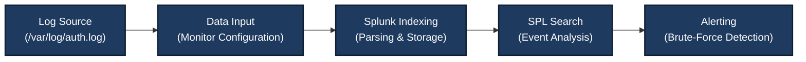

# Module 3: SIEM & Log Management — Comprehensive Lab Report

## 📋 Module Overview

This module focuses on one of the core tools used by a Security Operations Center (SOC) Analyst: **Security Information and Event Management (SIEM)**.

The primary objective is to understand how a SIEM system collects, parses, indexes, and analyzes logs from different sources to help detect security incidents. During this module, Splunk Enterprise was deployed in a Kali Linux virtual machine, Linux authentication logs were ingested, basic Search Processing Language (SPL) queries were explored, and a scheduled alert was configured to detect repeated failed login attempts.

## 🎯 Module Objectives

The objectives of this module are:

1. **SIEM Deployment:** Install and configure Splunk Enterprise on a Kali Linux VM.
2. **Log Ingestion:** Configure Splunk to monitor and ingest Linux authentication logs from `/var/log/auth.log`.
3. **SPL (Search Processing Language):** Use basic SPL queries to filter, search, and analyze security events.
4. **Alert Engineering:** Configure a scheduled alert to detect more than five failed login events within a one-minute evaluation window.
5. **Dashboard Creation:** Optionally create a basic dashboard to visualize security events.

---

## 🛠️ Tools & Technologies Used

| Component | Details |
|---|---|
| SIEM Platform | Splunk Enterprise v10.0.2 |
| Operating System | Kali Linux VM |
| Log Source | `/var/log/auth.log` |
| Web Browser | Firefox |
| Web Interface | `http://localhost:8000` |
| Query Language | Splunk Search Processing Language (SPL) |

---

# 🔬 Lab 1: Splunk Installation & Basic Configuration

## 1.1 Objective

Install Splunk Enterprise on a Kali Linux virtual machine, configure the administrator account, and verify the installation by searching Splunk's internal logs.

## 1.2 Detailed Execution Steps

### Step 1: Download Splunk Enterprise

Download the appropriate Splunk Enterprise `.deb` package from the official Splunk website.

If the direct download URL is available, `wget` can be used to download the package:

```bash
wget -O splunk.deb "YOUR_OFFICIAL_SPLUNK_DOWNLOAD_URL"
```

Replace the placeholder with the actual download URL. The URL may require authentication or acceptance of Splunk's download terms.

### Step 2: Install Splunk

Install the downloaded Debian package. If the file has the original filename used in this lab, run:

```bash
sudo dpkg -i splunk-10.0.2-e2d18b4767e9-linux-amd64.deb
```

If the package reports missing dependencies, resolve them before proceeding.

### Step 3: Start Splunk Enterprise

Navigate to the Splunk installation directory:

```bash
cd /opt/splunk/bin
```

Start Splunk and accept the license:

```bash
sudo ./splunk start --accept-license
```

Follow the prompts to create the administrator username and a strong password.

**Security note:** Use a unique password for the Splunk administrator account. Do not publish passwords, credentials, or other secrets in screenshots or repository files.

### Step 4: Access the Splunk Web Interface

Open Firefox and navigate to:

```text
http://localhost:8000
```

Log in using the administrator credentials configured during startup.

### Step 5: Verify Internal Logs

Open the Search & Reporting interface and run:

```spl
index=_internal | head 10
```

This query searches the internal Splunk index and returns up to ten matching events.

## 1.3 Expected Outcome & Verification

**Expected outcome:**

- Splunk Enterprise starts successfully.
- The Splunk Web interface is accessible.
- The administrator can log in.
- Internal Splunk events are searchable.

**Verification:** Successful login and search results from the `_internal` index indicate that Splunk is running and its internal logging is available.

## 1.4 Key Learnings & Troubleshooting

- **Splunk Architecture:** Understand the roles of forwarders, indexers, and search heads. In a standalone installation, several of these functions may be handled by one instance.
- **Startup Errors:** Review Splunk's internal logs if the service fails to start.
- **Log Location:** A commonly used diagnostic log is `/opt/splunk/var/log/splunk/splunkd.log`.
- **Port Conflicts:** Ensure that port `8000` is not being used by another service.
- **Web Access:** If the interface is unavailable, verify the service status and network configuration.

---

# 🔬 Lab 2: Forwarding Linux Logs to Splunk

## 2.1 Objective

Configure Splunk Enterprise to monitor and ingest Linux authentication logs from `/var/log/auth.log`, then verify the ingested events using SPL.

## 2.2 Detailed Execution Steps

### Step 1: Generate a Test Authentication Event

The following command appends a synthetic failed-login event to the authentication log:

```bash
echo "Oct 26 18:30:00 kali sshd[8888]: Failed password for invalid user hacker from 10.0.2.15 port 5555 ssh2" | sudo tee -a /var/log/auth.log
```

This is a manually created test record, not evidence of an actual SSH login attempt.

**Important:** The command writes directly to a system log. Use synthetic events only in an authorized lab environment. The exact log path and logging service vary by Linux distribution; Kali systems may use a different authentication-log configuration.

### Step 2: Configure the Data Input in Splunk

In the Splunk Web interface:

1. Navigate to **Settings → Data Inputs**.
2. Select **Files & Directories**.
3. Choose **New Local File & Directory**.
4. Enter the log path:

   ```text
   /var/log/auth.log
   ```

5. Set the source type to:

   ```text
   linux_secure
   ```

6. Select the index:

   ```text
   main
   ```

7. Save the input configuration.

Splunk must have permission to read the file. If the file is inaccessible, review the Splunk service account's permissions and the system's logging configuration.

### Step 3: Verify Log Ingestion

Run the following SPL query:

```spl
index=main sourcetype=linux_secure "Failed password"
```

Inspect the returned events and confirm that the expected test record appears.

Depending on the system and input configuration, the host field may be populated differently. Verify the actual event fields instead of assuming that `host=kali` will always be present.

## 2.3 Expected Outcome & Verification

**Expected outcome:**

- Splunk monitors the configured authentication log.
- New log records are indexed and searchable.
- The test event can be located using an SPL query.

**Verification:** Search results should contain the synthetic failed-login event with the expected source type and index.

## 2.4 Key Learnings & Troubleshooting

- **Sourcetype:** A suitable sourcetype helps Splunk interpret log structure and extract fields.
- **File Permissions:** Splunk must be able to read the monitored log.
- **Log Availability:** Confirm that `/var/log/auth.log` exists and is receiving events on the target system.
- **Input Configuration:** Verify the file path, index, and sourcetype.
- **Search Time Range:** Ensure the search time range includes the event timestamp.
- **Duplicate Ingestion:** Avoid configuring overlapping inputs for the same log without understanding the consequences.

---

# 🔬 Lab 3: Creating Brute-Force Detection Alerts

## 3.1 Objective

Create a scheduled Splunk alert to identify repeated failed-login events that may indicate an SSH brute-force attempt.

## 3.2 Detailed Execution Steps

### Step 1: Create the Detection Search

Run the following SPL query:

```spl
index=main sourcetype=linux_secure "Failed password"
```

This search returns matching failed-password events from the selected index and sourcetype.

For a more focused detection, aggregate events by source IP address:

```spl
index=main sourcetype=linux_secure "Failed password"
| rex "from (?<src_ip>\d{1,3}(?:\.\d{1,3}){3})"
| stats count AS failed_attempts by src_ip
| where failed_attempts > 5
```

This example extracts a source IP from matching event text, counts the events by source IP, and returns groups with more than five matching events in the selected search time range.

The extraction pattern is intended for the example log format. Validate it against the actual events before using it operationally.

### Step 2: Save the Search as an Alert

1. Run the detection search in Splunk Search & Reporting.
2. Select **Save As → Alert**.
3. Configure the alert settings.

Use the following configuration as a starting point:

| Setting | Value |
|---|---|
| Title | `Brute Force Detection - Failed Logins` |
| Alert Type | Scheduled |
| Schedule | Every minute |
| Trigger Condition | Number of search results greater than 0, when using the filtered aggregation query |
| Trigger Action | Add to Triggered Alerts |

**Important distinction:** If you use the original unaggregated query, a condition such as `search count > 5` can evaluate the total number of matching events returned by the search. It does not necessarily mean that one source IP generated more than five attempts. The aggregation query above is more appropriate when the goal is to detect more than five matching events per source IP.

Configure the search time range and schedule so they match the intended detection window. A scheduled search running every minute does not automatically guarantee that it evaluates only the previous minute.

### Step 3: Generate Test Events

In an isolated lab, generate several synthetic failed-login records using the test-event method from Lab 2.

For example, the following loop appends six synthetic records with the same source IP:

```bash
for i in {1..6}; do
  echo "$(date '+%b %d %H:%M:%S') kali sshd[8888]: Failed password for invalid user testuser from 10.0.2.15 port $((5500+i)) ssh2"
done | sudo tee -a /var/log/auth.log
```

These are fabricated log entries. They test the log-ingestion and alerting workflow; they do not perform six real SSH authentication attempts.

### Step 4: Verify the Alert

After the scheduled search has run:

1. Open the Splunk **Alerts** area.
2. Navigate to **Triggered Alerts** or the corresponding alert history view.
3. Check whether the alert fired.
4. Inspect the triggering search results and event timestamps.

The alert should trigger when the configured condition is met and the relevant events have been indexed within the selected time range.

## 3.3 Expected Outcome & Verification

**Expected outcome:**

- A scheduled alert is configured.
- The search identifies matching failed-login events.
- Synthetic test events are indexed.
- The alert fires when the configured condition is satisfied.

**Verification:** Review the alert history and search results. Do not rely only on a saved alert configuration as proof that detection works.

## 3.4 Key Learnings & Troubleshooting

- **Alert Thresholds:** Detection thresholds should reflect the intended behavior and search logic.
- **Time Windows:** The search time range and schedule determine which events are evaluated.
- **Aggregation:** Grouping by source IP can distinguish repeated attempts from one source from distributed activity.
- **Throttling:** Configure alert suppression or throttling where appropriate to reduce duplicate notifications.
- **Troubleshooting:** If the alert does not trigger, check event ingestion, search results, time range, schedule, trigger conditions, and alert permissions.
- **Detection Limitations:** A burst of failed logins may indicate brute-force activity, but it should be investigated with additional context before classifying an incident.

---

# 🏛️ SIEM Workflow Architecture

The following diagram illustrates a typical SIEM log-analysis workflow. In a standalone Splunk deployment, the forwarder, indexing, and search functions may not be separate machines or services.



---

## 📸 Screenshots & Evidence

### Screenshot 1 — Splunk Dashboard

*This screenshot shows the Splunk Web interface after successful login.*


### Screenshot 2 — Internal Log Search

*This screenshot shows the search results for internal Splunk logs.*


### Screenshot 3 — Linux Log Ingestion

*This screenshot shows the ingestion of Linux authentication log events into Splunk.*


### Screenshot 4 — Sourcetype Filtering

*This screenshot shows log searches filtered by the `linux_secure` sourcetype.*


### Screenshot 5 — Alert Configuration

*This screenshot shows the configuration of the brute-force detection alert.*


### Screenshot 6 — Triggered Alert

*This screenshot shows the alert history after a detection condition has been met.*


---

## 💡 Key Takeaways from Module 3

1. **SIEM as a Central Platform:** A SIEM helps centralize and analyze security events from different log sources.
2. **Log Ingestion:** Correct data-input configuration, file permissions, index selection, and sourcetype selection are essential for reliable log collection.
3. **SPL for Analysis:** SPL supports searching, filtering, aggregating, and correlating log events.
4. **Alert Engineering:** Well-designed alerts help analysts identify suspicious activity and prioritize investigations.
5. **Time-Window Awareness:** Alert schedules, search windows, and thresholds must work together correctly.
6. **Evidence-Based Detection:** Synthetic test logs are useful for validating a lab workflow but should not be presented as evidence of real attack activity.

---

## ✅ Module 3 Completion Checklist

Mark each item as complete only after confirming that the corresponding task was performed.

- [x] Understood the core components and purpose of a SIEM.
- [x] Installed Splunk Enterprise.
- [x] Configured Splunk to ingest Linux authentication logs.
- [x] Practiced basic SPL searches.
- [x] Configured and tested a brute-force detection alert.
- [x] Documented the lab workflow with screenshots.

**Note:** Keep an item checked only if you personally completed and verified that task. Otherwise, change `[x]` to `[ ]`.

---

## Conclusion

This module provided practical experience with SIEM deployment, Linux authentication log ingestion, SPL-based event analysis, and scheduled alert configuration using Splunk Enterprise.

The labs demonstrated how authentication events can be collected, searched, and evaluated for patterns that may indicate repeated login failures. They also highlighted the importance of correct sourcetype configuration, time-window selection, alert thresholds, and evidence validation.

These skills form a foundation for further SOC training, including centralized log management, detection engineering, incident triage, and security monitoring.
