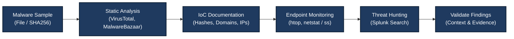

# Module 4: Endpoint Security & Malware Analysis — Comprehensive Lab Report

## 📋 Module Overview

This module focuses on the essential skills required to understand, analyze, and detect malicious activity on endpoints running Windows or Linux. The primary objective is to understand how malware can be investigated safely, how static and dynamic analysis differ, and how endpoint-related events can be investigated using a SIEM platform.

The practical exercises cover static malware triage using VirusTotal and MalwareBazaar, threat hunting with Splunk, and monitoring Linux processes and network connections.

## 🎯 Module Objectives

The objectives of this module are:

1. **Malware Triage:** Perform static analysis of a malware sample without executing it.
2. **Threat Intelligence:** Use OSINT platforms such as VirusTotal and MalwareBazaar to investigate Indicators of Compromise (IoCs).
3. **Threat Hunting:** Search for suspicious activity, such as failed root-login attempts, using Splunk.
4. **Dynamic Analysis Concepts:** Monitor running processes and network connections to understand live system behavior.
5. **Documentation:** Record investigation findings, potential IoCs, and behavioral observations.

---

## 🛠️ Tools & Technologies Used

| Component | Tool / Technology |
|---|---|
| OSINT Platforms | VirusTotal, MalwareBazaar |
| SIEM Platform | Splunk Enterprise |
| Process Monitoring | `htop` |
| Network Monitoring | `netstat` |
| Operating System | Kali Linux VM |
| Log Source | `/var/log/auth.log` |
| Search Language | Splunk Search Processing Language (SPL) |

---

# 🔬 Lab 1: Static Malware Analysis (VirusTotal & MalwareBazaar)

## 1.1 Objective

Perform static analysis on a malware sample without executing it. Use MalwareBazaar and VirusTotal to investigate file reputation, identify potential malware classifications, and document available Indicators of Compromise.

## 1.2 Detailed Execution Steps

### Step 1: Sample Acquisition and Identification

1. Navigate to [MalwareBazaar](https://bazaar.abuse.ch/).
2. Search for or select an appropriate sample from the database, such as the example named `TikTok 18.apk`.
3. Review the available sample information.
4. Record the SHA256 hash, file name, and other available metadata.

**Safety note:** Do not execute the sample. If downloading is necessary, use an isolated malware-analysis environment and follow appropriate containment procedures. A hash lookup can often provide useful intelligence without downloading the file.

### Step 2: Analyze the Hash with VirusTotal

1. Open [VirusTotal](https://www.virustotal.com/).
2. Search for the sample's SHA256 hash.
3. Review the detection summary.
4. Examine available vendor classifications and file-analysis details.
5. Record relevant findings for the investigation.

For example, a hypothetical detection ratio such as `4/66` means that four of 66 reporting engines flagged the sample at the time of the report.

**Important:** A detection ratio is time-dependent and does not independently prove that a file is malicious or harmless. Record the actual result observed during the investigation rather than treating an example ratio as a verified result.

### Step 3: Review MalwareBazaar Metadata

Return to MalwareBazaar and review the sample's available metadata, including:

- File name.
- SHA256 hash.
- File size.
- File type.
- First-seen information, if available.
- Malware family or threat classification, if provided.
- Other available tags and contextual information.

### Step 4: Document Indicators of Compromise

Record the relevant indicators in your investigation notes.

| Field | Description |
|---|---|
| File Name | Name of the analyzed sample |
| SHA256 | Cryptographic hash used to identify the sample |
| File Type | Format identified by the available analysis |
| Detection Ratio | VirusTotal result observed during the investigation |
| Threat Classification | Vendor or database classification, if available |
| Source | MalwareBazaar and/or VirusTotal |
| Notes | Uncertainties, timestamps, and other relevant context |

Only populate fields with values supported by the results you actually observed.

## 1.3 Expected Outcome & Verification

**Expected outcome:**

- The sample is investigated without being executed.
- The SHA256 hash is identified and documented.
- Available file metadata and threat-intelligence information are reviewed.
- Potential IoCs are recorded for further investigation.

**Verification:** Confirm that the hash and metadata are consistent across the available sources and that the investigation notes distinguish observed facts from vendor assessments.

## 1.4 Key Learnings & Troubleshooting

- **Hashing:** SHA256 provides a useful identifier for a file and helps analysts compare samples across sources.
- **Threat Intelligence:** VirusTotal aggregates detection information from multiple security vendors, while MalwareBazaar provides information about malware samples.
- **Detection Limitations:** A low or zero detection ratio does not prove that a sample is safe. It may be new, uncommon, modified, or not recognized by the reporting engines.
- **Classification Differences:** Security vendors may assign different names or categories to the same sample.
- **Safe Handling:** Avoid executing suspicious samples on a normal workstation.
- **Privacy:** Do not upload confidential or sensitive files to public analysis services without authorization.

---

# 🔬 Lab 2: Threat Hunting in Splunk (Failed Root Logins)

## 2.1 Objective

Investigate suspicious login activity targeting the Linux `root` account by searching authentication events in Splunk.

## 2.2 Detailed Execution Steps

### Step 1: Generate a Synthetic Failed-Login Event

The following command appends a sample failed-login record to the authentication log:

```bash id="u0dbp4"
echo "Oct 26 20:00:00 kali sshd[1234]: Failed password for root from 10.0.2.15 port 5555 ssh2" | sudo tee -a /var/log/auth.log
```

This creates a synthetic test record. It does not perform a real SSH login attempt.

**Important:** Use this method only in an authorized lab environment. The timestamp is illustrative, and manually appended log records may not have the same structure or parsing behavior as events generated by the actual authentication service.

### Step 2: Search for Failed Root Logins

Open Splunk Search & Reporting and run:

```spl id="wd71xc"
index=main sourcetype=linux_secure "Failed password for root"
```

This query searches the `main` index for events with the specified sourcetype and matching text.

Ensure that the selected time range includes the event timestamp.

### Step 3: Analyze the Search Results

Inspect the returned event and expand its details.

Review fields such as:

- `host`
- `source`
- `sourcetype`
- `user`, if extracted
- `src_ip`, if extracted
- Event timestamp
- The original raw event

**Note:** Fields such as `user` and `src_ip` may not be automatically extracted for every log format. If they are missing, inspect the raw event and consider extracting the fields explicitly.

For example, the following SPL query extracts the username and source IP from matching event text:

```spl id="f7tt8q"
index=main sourcetype=linux_secure "Failed password for root"
| rex "Failed password for (?<user>\S+) from (?<src_ip>\d{1,3}(?:\.\d{1,3}){3})"
| table _time host user src_ip source sourcetype _raw
```

This extraction is designed for the example log format and should be validated against the actual data.

## 2.3 Expected Outcome & Verification

**Expected outcome:**

- The relevant failed-root-login event is searchable in Splunk.
- The event's timestamp and raw content can be inspected.
- Available fields can be reviewed for further investigation.

**Verification:** Confirm that the search returns the expected synthetic event. Clearly distinguish manually created test records from genuine authentication activity.

## 2.4 Key Learnings & Troubleshooting

- **Hypothesis-Driven Hunting:** Starting with a specific hypothesis, such as repeated attempts to access the root account, makes investigations more focused.
- **Time Range:** A valid query may return no results if the selected time range excludes the event.
- **Log Ingestion:** Verify that the log source is monitored and that events are indexed.
- **Field Extraction:** Do not assume every expected field exists; validate extraction against raw events.
- **Contextual Analysis:** A failed login alone does not establish a successful compromise or a confirmed brute-force attack.

---

# 🔬 Lab 3: Dynamic Analysis Concepts (Process & Network Monitoring)

## 3.1 Objective

Understand the principles of live system monitoring by observing running processes and network connections on a Linux endpoint.

This lab demonstrates system-monitoring techniques. Monitoring a normal system does not, by itself, constitute a complete dynamic malware analysis.

## 3.2 Detailed Execution Steps

### Step 1: Install and Run htop

Install `htop` if it is not already available:

```bash id="5ikxwy"
sudo apt update
sudo apt install htop -y
```

Launch the process monitor:

```bash id="pqyd2e"
htop
```

Review the following information:

- Running processes.
- Process IDs (PIDs).
- CPU utilization.
- Memory utilization.
- Process ownership, where displayed.
- Parent-child process relationships, where available.

Look for unusual resource consumption or unexpected processes, but avoid treating high CPU or memory usage as proof of malicious activity without additional evidence.

Press `q` to exit `htop`.

### Step 2: Inspect Network Connections

Run:

```bash id="p8p52v"
sudo netstat -tulnp
```

The options mean:

- `-t`: Show TCP sockets.
- `-u`: Show UDP sockets.
- `-l`: Show listening sockets.
- `-n`: Display numeric addresses and port numbers.
- `-p`: Show the associated process and PID when permitted.

This command focuses on listening sockets rather than every established connection.

To inspect a broader set of TCP and UDP sockets, use:

```bash id="z4byc7"
sudo netstat -tunap
```

If `netstat` is unavailable, install the `net-tools` package or use the modern alternative:

```bash id="j31bgx"
sudo ss -tunap
```

### Step 3: Analyze Process and Network Behavior

Review the process list and network output.

Consider the following questions:

1. Are any processes consuming unusually high system resources?
2. Are unfamiliar processes running under privileged accounts?
3. Are there unexpected listening ports?
4. Can a network socket be associated with a process?
5. Does the observed behavior differ from the normal system baseline?

Document the process name, PID, user, network endpoint, timestamp, and supporting evidence where available.

Do not terminate unfamiliar processes solely because they look suspicious. Validate their identity and role before taking action.

## 3.3 Expected Outcome & Verification

**Expected outcome:**

- Running processes and resource utilization are visible in `htop`.
- Listening sockets and network endpoints can be inspected.
- Process ownership and available network metadata can be reviewed.
- Potential anomalies can be documented for further investigation.

**Verification:** Confirm that `htop` displays live process information and that `netstat` or `ss` displays the sockets available on the system.

## 3.4 Key Learnings & Troubleshooting

- **System Baselines:** Understanding normal system behavior helps distinguish expected activity from potential anomalies.
- **Privileges:** Root privileges may be required to display process information associated with all sockets.
- **Tool Availability:** `netstat` may require the `net-tools` package.
- **Visibility Limitations:** A snapshot of processes or sockets does not reveal the complete history of system activity.
- **Dynamic Analysis:** Observing a live system can reveal behavior that static file inspection cannot, but a dedicated malware-analysis lab requires additional isolation, monitoring, and evidence collection.

---

# 🏛️ Endpoint Analysis Workflow

The following workflow summarizes the investigation process covered in this module.



---

## 📸 Screenshots & Evidence

### Screenshot 1 — VirusTotal Detection Results

*This screenshot shows the detection ratio and available threat classifications reported by VirusTotal.*


### Screenshot 2 — MalwareBazaar File Information

*This screenshot shows the file metadata and hash information available from MalwareBazaar.*


### Screenshot 3 — Threat Hunting Search Results

*This screenshot shows the Splunk search results for failed root-login events.*


### Screenshot 4 — Threat Hunting Event Details

*This screenshot shows the event details and any fields extracted from the matching log record.*


### Screenshot 5 — Live Process Monitoring (htop)

*This screenshot shows real-time process activity and resource utilization.*


### Screenshot 6 — Network Connections (netstat)

*This screenshot shows network sockets and listening ports reported by `netstat`.*


---

## 💡 Key Takeaways from Module 4

1. **Static vs. Dynamic Analysis:** Static analysis examines a file without executing it, while dynamic analysis observes behavior during execution in a controlled environment.
2. **Threat Intelligence Context:** File hashes and reputation data help identify known samples, but findings must be interpreted in context.
3. **Endpoint Monitoring:** Tools such as `htop`, `netstat`, and `ss` help analysts inspect processes and network sockets.
4. **SIEM Threat Hunting:** Targeted searches in Splunk help investigate suspicious authentication events that may not already have generated alerts.
5. **Evidence Validation:** A suspicious indicator is a lead for investigation, not automatic proof of compromise.
6. **Safe Malware Handling:** Suspicious files should be handled in an isolated environment, and samples should never be executed on a normal workstation.

---

## ✅ Module 4 Completion Checklist

Mark each task as complete only after performing and verifying it.

- [x] Reviewed static malware analysis using VirusTotal and MalwareBazaar.
- [x] Documented available IoCs from the sample investigation.
- [x] Searched for failed root-login events in Splunk.
- [x] Practiced process monitoring with `htop`.
- [x] Inspected network sockets using `netstat` or an equivalent tool.
- [x] Documented the lab procedures and screenshot evidence.

**Note:** Keep a checkbox marked as complete only if you personally performed and verified that activity. Otherwise, change `[x]` to `[ ]`.

---

## Conclusion

This module introduced practical techniques for endpoint monitoring, malware triage, threat-intelligence research, and SIEM-based threat hunting.

The exercises demonstrated how to investigate a file using its hash, review reputation data from external intelligence sources, search authentication logs for suspicious activity, and inspect live Linux processes and network sockets.

These skills form a foundation for further endpoint detection and response (EDR), malware analysis, incident response, and SOC threat-hunting exercises.
