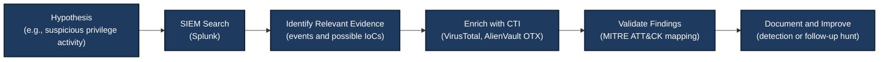

# Module 6: Threat Hunting & Cyber Threat Intelligence (CTI) — Comprehensive Lab Report

## 📋 Module Overview

This module marks the transition from a reactive Security Operations Center (SOC) Analyst, who primarily responds to alerts, to a proactive Threat Hunter who searches for suspicious activities that automated detections may miss.

The primary objective was to understand Threat Hunting methodologies and the integration of Cyber Threat Intelligence (CTI). The labs explored hypothesis-driven hunting, mapping attacker behavior to the MITRE ATT&CK framework, searching Linux authentication logs in Splunk, and enriching Indicators of Compromise (IoCs) using open-source intelligence (OSINT) platforms such as VirusTotal and AlienVault Open Threat Exchange (OTX).

## 🎯 Module Objectives

By completing this module, the following learning objectives were addressed:

1. **Threat Hunting Methodologies:** Understand the hunting loop: Hypothesis → Investigation → Discovery → Automation.
2. **MITRE ATT&CK Framework:** Learn to map observed attacker behaviors to relevant tactics, techniques, and procedures (TTPs).
3. **SIEM Hunting:** Use Splunk to search Linux authentication logs for suspicious privilege-related activity.
4. **OSINT & CTI:** Examine IP address reputation and related intelligence using VirusTotal and AlienVault OTX.
5. **Hypothesis-Driven Analysis:** Form testable hypotheses and validate them against available log data.

---

## 🛠️ Tools & Technologies Used

| Category | Tool / Technology |
|---|---|
| SIEM Platform | Splunk Enterprise v10.0.2 |
| Threat Intelligence Platforms | VirusTotal, AlienVault OTX |
| Threat Framework | MITRE ATT&CK |
| Operating System | Kali Linux VM |
| Log Source | `/var/log/auth.log` |
| Search Language | Splunk Search Processing Language (SPL) |

---

## 🔬 Lab 1: Threat Hunting with MITRE ATT&CK — Privilege-Related Activity

### 1.1 Objective

To investigate suspicious privilege-related activity in Linux authentication logs using Splunk and understand how observed behavior can be mapped to the MITRE ATT&CK framework.

The original hunting hypothesis was that a user might attempt to obtain a root shell by running `/bin/bash` through `sudo`.

**MITRE ATT&CK mapping note:** Technique **T1068 — Exploitation for Privilege Escalation** specifically refers to exploiting software vulnerabilities to elevate privileges. A `sudo` command launching a root shell does not, by itself, demonstrate exploitation. Depending on the evidence, the activity may be better described as suspicious privilege use or mapped to another relevant technique. Technique mapping should follow the observed behavior rather than the initial hypothesis.

### 1.2 Detailed Execution Steps

#### Step 1: Formulate the hypothesis

The hunting hypothesis was:

> A user may attempt to obtain a root shell by executing `/bin/bash` through `sudo`. Searching authentication logs for this command may reveal evidence of the activity.

A good hunting hypothesis should be specific, testable, and connected to evidence that can be collected.

#### Step 2: Generate a simulated log entry

The following command was used to append a sample event to `/var/log/auth.log`:

```bash
echo "Oct 26 21:40:00 kali sudo: hacker : TTY=pts/0 ; PWD=/home/hacker ; USER=root ; COMMAND=/bin/bash" | sudo tee -a /var/log/auth.log
```

**Important:** This command manually writes a text line to a log file. It does not execute `/bin/bash` as root, authenticate the `hacker` account, or prove that a real privilege-escalation attempt occurred. It is useful for testing log ingestion and search logic.

#### Step 3: Search in Splunk

Run the following SPL query:

```spl
index=* sourcetype=linux_secure "COMMAND=/bin/bash"
```

This searches events in the selected indexes for the specified sourcetype and command text.

If the query returns no results, check the selected time range, confirm the actual index and sourcetype, and verify that the log source is being ingested.

For a more targeted search, replace `*` with the index containing the Linux authentication events, for example:

```spl
index=main sourcetype=linux_secure "COMMAND=/bin/bash"
```

Use `index=main` only if the events are actually stored in that index.

#### Step 4: Inspect the event details

Expand the matching event and review the fields or text available in the event.

Expected values in the manually generated sample include:

| Field | Expected value |
|---|---|
| `USER` | `root` |
| `COMMAND` | `/bin/bash` |
| `PWD` | `/home/hacker` |
| `TTY` | `pts/0` |
| `process` | May be extracted as `sudo`, depending on the event format and field extraction configuration |

These values are part of the simulated log line. Splunk may display them as raw text rather than automatically extracted fields. If necessary, configure field extraction or use SPL commands to parse the event.

### 1.3 Expected Outcome & Verification

- **Expected outcome:** Locate the simulated event containing `COMMAND=/bin/bash`.
- **Verification:** Confirm that the search returns the manually appended line and inspect its raw text and extracted fields.
- **Interpretation:** The result validates the log-search workflow. It does not establish that a real attacker exploited a vulnerability or successfully escalated privileges.

### 1.4 Key Learnings & Troubleshooting

- **Hypothesis-driven hunting:** Begin with a testable question, then search for evidence that supports or contradicts it.
- **MITRE ATT&CK mapping:** Select a technique based on observed behavior and supporting evidence.
- **Log ingestion:** Verify the correct source, index, sourcetype, and time range when searches return no results.
- **Field extraction:** Do not assume that every key-value pair in a raw event will automatically appear as a structured Splunk field.
- **Evidence quality:** Clearly label manually generated events as test data and distinguish them from production telemetry.

---

## 🔬 Lab 2: Threat Intelligence & IoC Enrichment — OSINT

### 2.1 Objective

To investigate an IP address using open-source threat intelligence platforms and understand how reputation, related infrastructure, and community reports contribute to security analysis.

The IP address examined in this lab was `8.8.8.8`.

### 2.2 Detailed Execution Steps

#### Step 1: Examine the IP address in VirusTotal

1. Open [VirusTotal](https://www.virustotal.com/).
2. Search for the IP address `8.8.8.8`.
3. Review the detection ratio and community reputation information displayed for the IP.
4. Inspect the **Details** and **Relations** sections, including passive DNS information where available.
5. Record the displayed values and the date of the investigation.

The original lab notes reported a detection ratio of `0/92` and a community reputation score of `564`. These are recorded observations from the lab notes, not independently verified current values. Reputation data and detection counts can change over time.

#### Step 2: Examine the IP address in AlienVault OTX

1. Open [AlienVault OTX](https://otx.alienvault.com/).
2. Search for `8.8.8.8`.
3. Review related threat intelligence pulses.
4. Examine passive DNS and URL-related information, if available.
5. Record the results and investigation date.

The original lab notes reported `0` pulses, `500+` passive DNS entries, and `9` related URLs. These figures should be treated as recorded lab observations and rechecked on the platform if current values are required.

#### Step 3: Build context from multiple sources

Compare the results from both platforms and consider:

- Whether the IP is associated with a known organization or service.
- Whether threat intelligence reports identify suspicious activity.
- Whether related domains, URLs, or infrastructure provide useful context.
- Whether the information is recent and relevant to the environment being investigated.

The lab notes associated `8.8.8.8` with Google LLC. A reputation result with no detections or threat pulses is useful context, but it does not prove that an IP is universally safe or that every connection involving it is benign.

### 2.3 Expected Outcome & Verification

- **Expected outcome:** Collect and compare reputation and relationship information for the IP address using two OSINT platforms.
- **Verification:** Review each platform's results and document the observations, the date, and any limitations.
- **Interpretation:** Threat intelligence helps analysts assess context and prioritize investigation. It should be combined with internal telemetry and other evidence before making a final decision.

### 2.4 Key Learnings & Troubleshooting

- **Context matters:** An IP address should not be judged by reputation alone. Its role, timing, related infrastructure, and behavior all matter.
- **Data changes:** Detection ratios, pulse counts, passive DNS records, and community reputation may change.
- **No results does not mean safe:** An unlisted IP may be new, uncommon, or simply absent from the data sources consulted.
- **Corroborate evidence:** Check multiple sources and internal logs before classifying activity as malicious or benign.
- **Record observations:** Include the lookup date and the exact values shown during the investigation.

---

## 🏛️ Threat Hunting & CTI Workflow

The following workflow summarizes the relationship between hypothesis-driven hunting, SIEM investigation, and threat intelligence enrichment.



### Workflow Explanation

1. **Hypothesis:** Define the suspicious behavior to investigate.
2. **SIEM search:** Search relevant logs in Splunk for supporting or contradictory evidence.
3. **Evidence and IoCs:** Identify events, IP addresses, domains, hashes, or other indicators when present.
4. **CTI enrichment:** Consult intelligence sources to add context to relevant indicators.
5. **Validation:** Correlate the available evidence and map observed behavior to MITRE ATT&CK where justified.
6. **Documentation and improvement:** Record the findings, limitations, and potential improvements to detections or future hunts.

**Note:** Not every hunt produces an IoC. A useful result may instead be a validated benign explanation, a gap in logging, or a new detection opportunity.

---

## 📸 Screenshots & Evidence

### Screenshot 1: Threat Hunting Search Results

*Shows the Splunk search results for the suspicious `sudo` command pattern.*


### Screenshot 2: Event Details

*Shows the event details associated with the matching log entry.*


### Screenshot 3: VirusTotal IoC Analysis

*Shows the VirusTotal reputation and detection information recorded during the IP lookup.*


### Screenshot 4: AlienVault OTX IoC Analysis

*Shows the AlienVault OTX threat intelligence information recorded for the same IP.*


---

## 💡 Key Takeaways from Module 6

1. **Proactive Defense:** Threat hunting investigates suspicious behavior that automated alerts may not detect.
2. **CTI Enrichment:** OSINT platforms provide additional context for investigating IP addresses, domains, and other indicators.
3. **MITRE ATT&CK:** A shared framework for describing and categorizing adversary behavior.
4. **Hypothesis-Driven Analysis:** A clear, testable hypothesis helps focus the investigation.
5. **Evidence-Based Conclusions:** A matching search result is not automatically proof of a real attack.
6. **Continuous Improvement:** Findings can inform future hunts, logging improvements, and detection engineering.

## ✅ Module 6 Completion Checklist

Mark an item as complete only if you performed and verified the corresponding activity.

- [x] Understood the fundamentals of threat hunting.
- [x] Practiced searching for suspicious privilege-related activity in Splunk.
- [x] Reviewed how to map observed behavior to MITRE ATT&CK.
- [x] Examined an IP address using VirusTotal and AlienVault OTX.
- [x] Documented the lab workflow and screenshot evidence.

---

## 📚 References

- [MITRE ATT&CK](https://attack.mitre.org/)
- [MITRE ATT&CK — Exploitation for Privilege Escalation (T1068)](https://attack.mitre.org/techniques/T1068/)
- [Splunk Documentation](https://docs.splunk.com/)
- [VirusTotal](https://www.virustotal.com/)
- [AlienVault OTX](https://otx.alienvault.com/)

---

**Module 6 Status:** Threat Hunting & Cyber Threat Intelligence (CTI) lab report documented.

**Repository:** [SOC Training Program](https://github.com/iftiurhossen11/soc-training-program)
